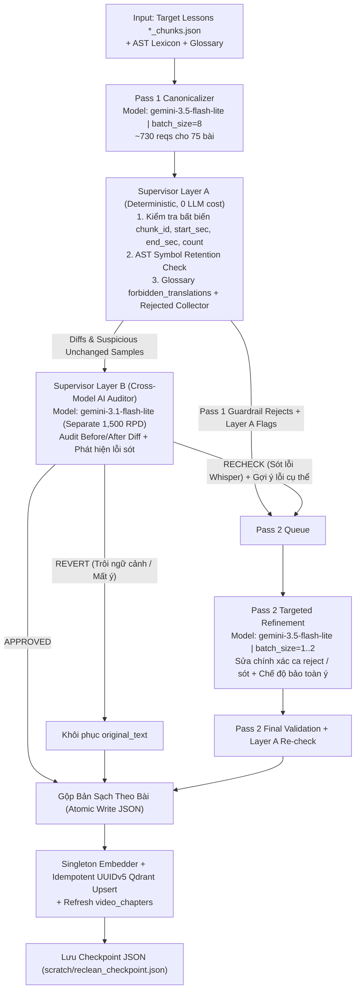

# Unified E2E Spec: `002-smart-reclean-pipeline` (Smart 2-Pass + 2-Layer Supervisor Transcript Reclean)

- **Ngày lập / Phiên bản:** `2026-11-20` (v1) -> `2026-11-23` (v2 - Swarm Verified)
- **Tác giả Spec:** `Coordinator + User`
- **Trạng thái:** `VERIFIED` (83/83 Lessons Cleaned; Swarm 3.8 Flash Audited; 34/34 Unit Regression PASS; Qdrant Parity 6,387/6,387; Multi-turn Benchmark Evaluated)
- **Phạm vi tác động (Layers):** `[x] Data/Glossary` `[x] AST Canonicalizer` `[x] Qdrant Upsert` `[x] Manifest video_chapters` `[x] Offline Supervisor & Checkpoint` `[ ] Runtime Chat/Router (Untouched)`

---

## 1. Constitution Check (`AGENTS.md` & Rigor Invariants)
- [x] **Zero Quick-Fix:** Cấm vá lỗi ASR ở runtime bằng regex chuỗi (như `"mạng" -> "mảng"` trong `app/`); toàn bộ làm sạch diễn ra tại lớp dữ liệu nguồn (`data/transcripts/*_chunks.json`), `lessons_manifest.json`, và Qdrant theo *Lớp bài toán (Problem Class)*.
- [x] **Zero Context Loss & Timestamp Immutability:** Không làm mất ý giảng, không thay đổi/làm trôi `chunk_id`, `start_sec`, `end_sec`, `start_label`, `end_label`, không được cắt bớt số lượng chunk của bài học. Mọi chỉnh sửa vi phạm semantic preservation đều bị Supervisor `REVERT` về `original_text`.
- [x] **Data/Code Separation:** Toàn bộ danh sách lỗi đồng âm Whisper (`forbidden_translations`) và thuật ngữ chuẩn đặt trong JSON (`data/metadata/cpp_academic_glossary.json`), tuyệt đối không hardcode từ điển lỗi trong mã Python `.py`.
- [x] **Zero Key Exposure & Runtime Isolation:** Sử dụng xoay đa key `GEMINI_API_KEYS` trong `.env` thông qua `--gemini`, tuyệt đối không in/log/commit API key, và **giữ nguyên 100%** `LLM_BASE_URL` / `LLM_MODEL_NAME` của hệ thống runtime (`Qwen/Qwen2.5-Coder-7B-Instruct` trên Kaggle).
- [x] **Data-Inspected Verification:** Không kết luận dữ liệu sạch chỉ dựa vào Exit Code 0; bắt buộc kiểm chứng trực tiếp file JSON sau ghi và `QdrantClient.scroll` + benchmark đối chiếu trước/sau.

---

## 2. Chẩn đoán Nguyên nhân Gốc & Problem Classes (`PC-R1` .. `PC-R5`)

### Hiện trạng Corpus & Động lực
- Tổng corpus: **83 bài học / 6,387 chunks** (`data/transcripts/`). Quét mẫu từ điển ASR cho thấy **34/83 bài** còn chứa lỗi đồng âm Whisper (ví dụ L3 `"++x/x++"`, L4: 13 chunks, L5 `"kính UV"`/`"phát bại trị"`, L6: 4 chunks, L35 `"hà hà phi"`, L53: 10 chunks, L56: 4 chunks, L57 `"petero"`).
- Sau Spec 001 (chỉ mới làm sạch sâu L1 và vá cục bộ một số điểm), benchmark 222 lượt `run_multiturn_benchmark.py --mode retrieval` đạt Retrieval Status `91.44%` nhưng `Multi-Grounding TS` tụt xuống **`86.94%`** (mục tiêu `Mục 16.3b`: hồi phục `>= 90%`).

### Problem Class `PC-R1`: Tải lại Embedder 83 lần trong `upsert_lesson_chunks_to_qdrant`
- **Bằng chứng code:** `scripts/canonicalize_transcripts_ast.py` (`upsert_lesson_chunks_to_qdrant`, dòng 1273–1279) khởi tạo mới `TextEmbedding(settings.EMBEDDING_MODEL_NAME)` (`intfloat/multilingual-e5-large`), `SparseTextEmbedding(settings.SPARSE_MODEL_NAME)` (`Qdrant/bm25`), và `QdrantClient` **trong mỗi lần gọi theo từng bài học**.
- **Hệ quả:** Khi chạy 75+ bài liên tiếp, thời gian load ONNX/FastEmbed bị nhân lên ~75–83 lần (gây trễ hàng chục phút và rủi ro tràn RAM trên Windows 16GB).

### Problem Class `PC-R2`: Thiếu Ngân sách RPD & Khả năng Resume theo Checkpoint
- **Bằng chứng code:** `build_arg_parser()` (`scripts/canonicalize_transcripts_ast.py`, dòng 1580) để `--batch-size 5` mặc định. Toàn bộ `6,387` chunks ở `batch_size=5` tốn `~1,278` requests chỉ riêng 1 lượt, sát trần **`1,500 RPD`** (`500 RPD × 3 keys` của `gemini-3.5-flash-lite`). Nếu chạy mù 2 lượt (`~2,556` reqs) sẽ cạn sạch RPD giữa chừng và mất toàn bộ tiến độ nếu không có checkpoint.
- **Nguyên nhân gốc:** Chưa tách Pass 1 rộng (`batch_size=8`) khỏi Pass 2 hẹp có giám sát, chưa dùng bucket RPD riêng của `gemini-3.1-flash-lite` cho Cross-Model Supervisor, và chưa có `--start-lesson`, `--end-lesson`, `--skip-cleaned`, `--checkpoint-file`.

### Problem Class `PC-R3`: `validate_canonical_chunk` Bỏ Rơi Ca Co Ngắn Hợp Lệ & Không Retry Từng Chunk
- **Bằng chứng code:** `validate_canonical_chunk(original_text, candidate_text)` (`scripts/canonicalize_transcripts_ast.py`, dòng 684–725) áp chuẩn cứng `0.82 <= len_ratio <= 1.18`, `0.80 <= wc_ratio <= 1.20`, `jaccard >= 0.55`.
- **Nguyên nhân gốc:** Các cụm phiên âm tiếng Việt nhiều từ rút về ký hiệu C++ chuẩn (ví dụ `"si cộng cộng"` [3 từ] -> `"C++"` [1 từ], `"ác xẹt mo đi phai ơ"` [6 từ] -> `"access modifier"` [2 từ], `"ti ơ rô"` -> `"T"`, `"sờ choắc"` -> `"struct"`) làm `wc_ratio` rơi dưới `0.80`, bị guardrail từ chối và rơi thẳng về `original_text` mà **không có lượt thử lại Pass 2 đơn lẻ (`batch_size=1`)** với ngữ cảnh tập trung.

### Problem Class `PC-R4`: Mất Kết nối Glossary C/C++ Cơ Bản Trong `_match_glossary_terms`
- **Bằng chứng dữ liệu & code:** `data/metadata/cpp_academic_glossary.json` đã có mục `arrays_and_strings` (dòng 89–102, chứa `"mạng"`, `"màng"`, `"câu chúc"`, `"cầu chức"`...), nhưng `_match_glossary_terms()` (`scripts/canonicalize_transcripts_ast.py`, dòng 441–484) chỉ kích hoạt 4 nhóm (`object_oriented_programming`, `sorting_algorithms`, `searching_algorithms`, `memory_and_pointers`) và bỏ qua hoàn toàn `arrays_and_strings` cũng như thiếu nhóm thuật ngữ C++ nhập môn / toán tử / đồng âm phổ biến (`"kính UV" -> "chu vi"`, `"phát bại trị" -> "giá trị"`, `"cộng cộng x" -> "++x"`, `"x cộng cộng" -> "x++"`).

### Problem Class `PC-R5`: Rủi ro 1-Pass Mù (Bỏ Sót Lỗi Tinh Vi hoặc Làm Trôi Nghĩa Ngữ Cảnh)
- **Nguyên nhân gốc:** Một lượt LLM sửa batch lớn (`batch_size=8`) vừa có xác suất **bỏ sót** (false negative — trả về y nguyên `original_text` dù có lỗi đồng âm tiếng Việt), vừa có rủi ro **sửa quá tay** (false positive — làm mất tên biến/hàm AST C++ hoặc đổi ý câu nói của giảng viên). Cần kiến trúc **2 tầng giám sát (Deterministic Layer A + Cross-Model AI Layer B)** ở giữa Pass 1 và Pass 2.

---

## 3. Kiến trúc Smart 2-Pass + 2-Layer Supervisor & Hợp đồng Hành vi

### Luồng Xử lý Tổng thể

### Hợp đồng Hành vi Pipeline (`REQ-R01` .. `REQ-R06`)

| ID | Thành phần / Tình huống | Pass 1 (`3.5-flash-lite`) | Supervisor Layer A (Deterministic) | Supervisor Layer B (`3.1-flash-lite`) | Pass 2 Targeted (`3.5-flash-lite`) | Điều kiện PASS |
|---|---|---|---|---|---|---|
| `REQ-R01` | Chunk có lỗi đồng âm C++/tiếng Việt học thuật | Batch 8 sửa với glossary đầy đủ | Xác nhận metadata bất biến + không còn `forbidden_translations` | Xác nhận diff giữ nguyên ý giảng | Bỏ qua nếu đã `APPROVED` | Text sạch, `start_sec`/`end_sec`/`chunk_id` giữ nguyên 100% |
| `REQ-R02` | Chunk bị `validate_canonical_chunk` từ chối ở Pass 1 (ví dụ `"si cộng cộng" -> "C++"`) | Trả về `rejected_by_guardrail` | Đưa vào `Pass 2 Queue` kèm mã lý do | Không cần tốn quota (Pass 1 chưa đổi text) | Retry đơn lẻ (`batch=1`) với relaxed phonetic contraction bound | Hoặc sửa sạch hợp lệ, hoặc an toàn fallback `original_text` |
| `REQ-R03` | Pass 1 bỏ sót lỗi (`unchanged`) ở bài có tín hiệu lỗi / `forbidden_translations` | Giữ nguyên `original_text` | Quét trúng từ cấm trong `cpp_academic_glossary.json` hoặc cụm nghi vấn -> gắn cờ `RECHECK` | Audit lô `unchanged` nghi vấn, trả danh sách `chunk_id` + `suspected_asr_error` | Sửa đúng `chunk_id` bị gắn cờ với `suspected_error_hint` | Lỗi sót được xử lý mà không re-run toàn bài |
| `REQ-R04` | Pass 1 sửa quá tay / làm mất symbol AST C++ hoặc đổi nghĩa câu | Sửa sai hoặc làm mất `ast_symbols` | Gắn cờ nếu symbol AST có trong bản gốc bỗng biến mất | Audit Before/After Diff: nếu phát hiện trôi nghĩa -> gắn `REVERT` | Không ép sửa lại nếu đã `REVERT` (hoặc retry bảo toàn nghiêm ngặt nếu có cờ `RECHECK`) | Đảm bảo **0% mất ngữ cảnh / sai kiến thức** |
| `REQ-R05` | Chạy nhiều bài / bị gián đoạn giữa chừng (Ctrl+C hoặc hết quota) | Chạy theo dải `--start-lesson .. --end-lesson` | Chặn ghi nếu count chunk không khớp | Xử lý xong từng bài mới commit checkpoint | Chạy xong Pass 2 mới upsert Qdrant | Chạy lại với `--resume` tự động bỏ qua bài đã `DONE` trong checkpoint |
| `REQ-R06` | Đồng bộ Qdrant cho hàng chục bài | — | Kiểm tra schema payload đầy đủ | — | — | Dùng **1 instance** `TextEmbedding` + `SparseTextEmbedding` + `QdrantClient` dùng chung suốt phiên CLI |

### Dự toán Quota & Thời gian Thực thi (Đã xác thực HTTP 200 cho cả 2 model)
- **Bucket 1 — `gemini-3.5-flash-lite` (3 keys = 45 RPM / 1,500 RPD):**
  - Pass 1 (`75` bài còn lại ≈ `5,831` chunks, `batch_size=8`): **`~730` requests**.
  - Pass 2 Targeted (`~5-10%` tổng chunks bị reject/gắn cờ, `batch_size=1..2`): **`~150–300` requests**.
  - Tổng Bucket 1: **`~880–1,030` requests** (an toàn dưới trần `1,500` RPD, dư `~470` RPD dự phòng retry).
- **Bucket 2 — `gemini-3.1-flash-lite` (3 keys = 45 RPM / 1,500 RPD riêng biệt — đã verify `200 OK` ngày 20/11):**
  - Supervisor Layer B audit theo bài (gom diff + nghi vấn ~20–25 chunks/request): **`~150–250` requests** (< 17% RPD của Bucket 2).
- **Ước lượng thời gian tổng:** **`~18–25 phút`** cho 75 bài còn lại (giảm mạnh nhờ `batch_size=8`, `max_concurrency=4`, và bỏ được 74 lần reload FastEmbed `intfloat/multilingual-e5-large`).

---

## 4. Đặc tả Sửa đổi Theo Thứ tự Phụ thuộc (Dependency-Ordered Changes)

1. **Lớp 1 — Từ điển Dữ liệu (`data/metadata/cpp_academic_glossary.json`):**
   - Giữ nguyên cấu trúc 5 nhóm hiện hữu (`sorting_algorithms`, `searching_algorithms`, `memory_and_pointers`, `arrays_and_strings`, `object_oriented_programming`).
   - Bổ sung nhóm mới `intro_cpp_and_operators` (hoặc `cpp_core_fundamentals`) chứa các cặp khái niệm & `forbidden_translations` chuẩn giáo trình đại học đã ghi nhận từ corpus thực tế (ví dụ: `"chu vi"` vs `"kính UV"`, `"giá trị"` vs `"phát bại trị"`, `"chỉ số"` vs `"chì số"`, `"++x / x++"` vs `"cộng cộng x / ích cộng cộng"`, `"iterator"` vs `"petero"`, `"biến"` vs `"biện"`, `"hàm"` vs `"hạn"`, `"nạp chồng"` vs `"nắp chồng"`).
   - Không sửa đổi bất kỳ câu hỏi benchmark nào trong bộ kiểm thử.

2. **Lớp 2 — Lexicon, Prompt & Phonetic Contraction Guardrail (`scripts/canonicalize_transcripts_ast.py`):**
   - `_match_glossary_terms()` (dòng 441–484): kích hoạt động nhóm `arrays_and_strings` (mảng, chuỗi, struct, xâu ký tự, bản ghi) và `intro_cpp_and_operators` dựa trên `title`, `keywords`, `ast_symbols` (hoặc luôn đưa `intro_cpp_and_operators` làm nền cho cả `cpp-core` và `cpp-oop`).
   - `build_correction_prompt()` (dòng 728–757): bổ sung chỉ dẫn rõ trong Rule 1 về việc khôi phục cả **từ tiếng Việt học thuật bị nhận dạng đồng âm** (dựa trên danh sách `forbidden_translations` đi kèm trong lexicon của bài) bên cạnh từ khóa tiếng Anh/AST; giữ nguyên nghiêm ngặt lệnh cấm tóm tắt và cấm đổi mốc thời gian.
   - `validate_canonical_chunk()` (dòng 684–725): giữ nguyên ngưỡng mặc định an toàn (`0.82..1.18`, `0.80..1.20`, `jaccard >= 0.55`) ở **Pass 1**; ở **Pass 2 targeted mode** (hoặc khi phát hiện co cụm phiên âm nhiều âm tiết thành ký hiệu AST/tiếng Anh ngắn như `"si cộng cộng" -> "C++"`, `"ác xẹt mo đi phai ơ" -> "access modifier"`), cho phép biên độ nới có kiểm soát (`wc_ratio >= 0.68`, `len_ratio >= 0.72`) nhưng **bắt buộc** giữ `_contains_cjk_or_hangul == False` và chuyển qua Layer B thẩm định ngữ nghĩa.

3. **Lớp 3 — Singleton Embedder & Qdrant Client (`scripts/canonicalize_transcripts_ast.py`):**
   - Tạo lớp nhẹ `QdrantSyncResources` (lazy-init `TextEmbedding`, `SparseTextEmbedding`, `QdrantClient` đúng **1 lần**).
   - `upsert_lesson_chunks_to_qdrant(..., resources: Optional[QdrantSyncResources] = None)` (dòng 1258+): dùng lại `resources` khi truyền từ CLI, giữ tương thích ngược hoàn toàn khi test gọi trực tiếp hàm không truyền `resources`.

4. **Lớp 4 — Dual-Layer Supervisor (`scripts/canonicalize_transcripts_ast.py`):**
   - `run_supervisor_layer_a(orig_chunks, pass1_chunks, lexicon, glossary) -> Dict[str, Any]`:
     - Kiểm tra **Metadata Immutability**: độ dài list, `chunk_id`, `start_sec`, `end_sec` khớp 100% (lệch -> hard-revert chunk/lesson).
     - Kiểm tra **AST Entity Retention**: các token kỹ thuật trong `lexicon["ast_symbols"]` xuất hiện ở `orig_chunks` không bị xóa mất một cách vô lý trong `pass1_chunks`.
     - Quét **Residual Glossary Forbidden Terms** trên `pass1_chunks` (bao gồm cả các chunk không đổi ở Pass 1) -> đưa vào `recheck_indices` kèm từ khóa nghi ngờ.
   - `run_supervisor_layer_b_audit(...)` (async/sync, gọi `gemini-3.1-flash-lite`):
     - Input: (a) các chunk đã sửa ở Pass 1 có độ thay đổi lớn (`jaccard < 0.78` hoặc mất symbol), (b) các chunk nằm trong `recheck_indices` hoặc bài thuộc danh sách nghi vấn còn `unchanged`.
     - Output JSON chuẩn (`[{"chunk_id": "...", "verdict": "APPROVED|RECHECK|REVERT", "reason": "..."}]`).
     - Fallback an toàn: nếu Supervisor B lỗi parse JSON hoặc timeout, KHÔNG phá hỏng Pass 1; log cảnh báo và chỉ giữ Pass 2 cho hàng đợi Layer A.

5. **Lớp 5 — Two-Pass Orchestrator & Checkpoint CLI (`scripts/canonicalize_transcripts_ast.py`):**
   - Mở rộng `build_arg_parser()` với các flag backward-compatible (mặc định giữ nguyên hành vi cũ nếu không truyền flag mới):
     - `--two-pass`: Bật Pass 1 (`--batch-size 8` khuyến nghị) -> Layer A -> Pass 2 targeted (`batch_size=1`).
     - `--supervisor`: Bật thêm Cross-Model AI Supervisor Layer B giữa Pass 1 và Pass 2.
     - `--supervisor-model`: Mặc định `gemini-3.1-flash-lite`.
     - `--start-lesson`, `--end-lesson`: Lọc dải `lesson_seq` (ví dụ `--start-lesson 2 --end-lesson 83`).
     - `--checkpoint-file`: Mặc định tắt (hoặc chỉ bật khi truyền path, ví dụ `scratch/reclean_checkpoint.json`), ghi trạng thái `DONE` (kèm `updated`, `reverted`, `pass2_fixed`, `qdrant_upserted`, `timestamp`) sau mỗi bài thành công.
     - `--resume`: Đọc `--checkpoint-file`, bỏ qua các bài đã đánh dấu `DONE`.
     - `--skip-clean-audit`: Hỗ trợ chạy lại chỉ những bài còn flagged nếu cần.

---

## 5. Cross-Layer Conflict & Quota Budget Matrix (Ma trận Chống Xung đột Chéo)

| Thay đổi dự kiến | Nguy cơ xung đột chéo tiềm ẩn | Cơ chế phòng ngừa trong Spec | Kiểm chứng bắt buộc |
|---|---|---|---|
| Kích hoạt Pass 2 cho các ca bị `wc_ratio` reject ở Pass 1 | Nới `wc_ratio` xuống `0.68` có thể làm LLM tóm tắt mất câu | Chỉ áp dụng trong Pass 2 targeted (`batch_size=1`) khi có co cụm thuật ngữ hoặc gợi ý từ Layer A/B + qua kiểm tra Layer B `REVERT` nếu mất ý | Unit test mô phỏng ca LLM tóm tắt quá ngắn -> bị chặn/REVERT; ca `"si cộng cộng" -> "C++"` -> PASS |
| Gọi Supervisor Layer B bằng `gemini-3.1-flash-lite` | Cạn quota chung với Pass 1 hoặc sai endpoint / timeout làm gãy phiên chạy | Đã xác thực `gemini-3.1-flash-lite` là bucket RPD độc lập; dùng chung vòng xoay đa key; nếu Layer B lỗi mạng/parse -> degraded an toàn về Layer A | Live probe HTTP 200 đã chạy (`200 Pong`) + Unit test mô phỏng Layer B timeout không crash |
| Thêm nhóm từ đồng âm vào `cpp_academic_glossary.json` | Phình prompt quá lớn (> token limit) hoặc nhầm thuật ngữ của bài khác | Chỉ bơm các mục khớp bài học qua `_match_glossary_terms()` + giới hạn số mục ưu tiên theo từng bài | Offline `--dry-run` in `sample_prompt_chars` trên L1..L83 đảm bảo `< 6,000 chars` |
| Singleton FastEmbed (`intfloat/multilingual-e5-large`) khi chạy `--sync-qdrant` | Tranh chấp RAM / CPU / GPU với `uvicorn` backend nếu chạy song song trên Windows 16GB | Tạm dừng `uvicorn` trong lúc chạy batch reclean; giữ batch embedding theo từng bài sau khi xong Pass 2 rồi mới giải phóng | Kiểm tra không có process `uvicorn` chạy song song; kiểm RAM ổn định suốt 83 bài |
| Ghi đè `*_chunks.json` và `lessons_manifest.json` | Crash giữa chừng làm file JSON hỏng (truncated) hoặc lệch giữa JSON với Qdrant | Ghi atomic (ghi `updated_chunks` hoàn chỉnh sau khi Pass 1 + Supervisor + Pass 2 xong cho bài đó), sau đó upsert Qdrant (idempotent UUIDv5), rồi mới ghi checkpoint `DONE`; `refresh_video_chapters_for_lessons` chạy cuối phiên | Unit test crash/resume checkpoint + kiểm chứng `QdrantClient.scroll` khớp số điểm & text |
| Đồng bộ môi trường `.env` | Sửa nhầm `LLM_BASE_URL` sang Gemini làm hỏng live Kaggle E2E runtime | Chỉ kích hoạt Gemini qua cờ `--gemini` trong `scripts/canonicalize_transcripts_ast.py`, **không chạm `.env`** | Kiểm tra `git diff .env` (không đổi) & test `ChatService` dùng đúng `settings.LLM_BASE_URL` |

---

## 6. Kế hoạch Nghiệm thu & Chống Hồi quy (Verification Plan)

1. **Stage A — Unit & Integration Tests mới (`tests/test_unseen_edges_and_canonicalizer.py`):**
   - `test_two_pass_retries_guardrail_rejected_phonetic_contraction`: Pass 1 reject cụm phiên âm rút gọn, Pass 2 (`batch=1`) sửa thành công và qua Layer A.
   - `test_supervisor_layer_a_detects_ast_loss_and_forbidden_terms`: Layer A phát hiện mất AST symbol và sót `forbidden_translations` từ `cpp_academic_glossary.json`.
   - `test_supervisor_layer_b_reverts_semantic_drift_and_flags_recheck`: Mock `gemini-3.1-flash-lite` trả về 1 `REVERT` (khôi phục `original_text`), 1 `RECHECK` (chuyển sang Pass 2), 1 `APPROVED`.
   - `test_qdrant_sync_resources_singleton_and_checkpoint_resume`: Xác nhận embedder chỉ khởi tạo 1 lần qua nhiều bài và `--resume` bỏ qua bài đã `DONE` trong checkpoint.
2. **Stage B — Offline Dry-Run & Pilot Run (L2–L5, L53, L57):**
   - Chạy `--audit-hotwords` + `--dry-run --two-pass --supervisor` xác nhận kích thước prompt & hotword coverage trên cả 83 bài.
   - Chạy Pilot `--apply --gemini --async-mode --two-pass --supervisor --sync-qdrant --refresh-chapters` trên L2, L3, L4, L5, L53, L57; dùng `Select-String` + `read_file` inspect trực tiếp diff trước/sau (`"++x"`, `"kính UV"`, `"phát bại trị"`, `"mạng"`, `"petero"`).
3. **Stage C — Full Remaining Batch Execution (`L6..L83`, trừ bài đã `DONE` trong checkpoint):**
   - Đảm bảo không chạy đồng thời `uvicorn`/`pytest` để bảo vệ RAM.
   - Chạy `--batch-size 8 --max-concurrency 4 --two-pass --supervisor --sync-qdrant --refresh-chapters --checkpoint-file scratch/reclean_checkpoint.json --resume`.
   - Kiểm chứng dữ liệu thực tế (`Select-String` quét 83 files tìm residual ASR errors + `QdrantClient.scroll` xác nhận điểm vector đã cập nhật).
4. **Stage D — Post-Clean Verification & Macro Benchmark:**
   - Chạy lại toàn bộ `pytest` (`86+` test cases, `0 failed`).
   - Chạy `scripts/run_multiturn_benchmark.py --mode retrieval` (50 sessions / 222 turns) đối chiếu với baseline trước reclean (`Multi-Grounding TS 86.94%`, `Retrieval Status 91.44%`), xác nhận phục hồi **`>= 90%`** mà không làm hồi quy các chỉ số khác.
   - Chạy `scripts/run_full_evaluation.py --suite all` xác nhận Router (`>= 91.00%`) và CRAG (`>= 83.67%`) không hồi quy.
